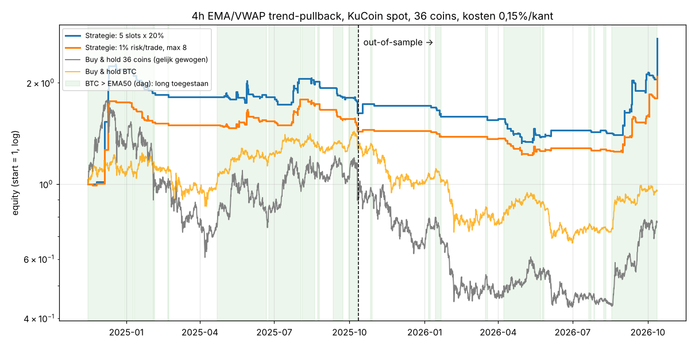

# EMA + VWAP multi-coin scanner voor KuCoin Spot: strategie-analyse

*Analysefase, 12 oktober 2026. Er is nog geen scanner of live code; dit document legt de basis voor v1.*

---

## 1. Samenvatting

1. **Laag timeframe werkt niet na kosten.** Op 1h-candles hebben EMA/VWAP-signalen hooguit een kleine bruto-edge (+0,0 tot +0,15% per trade). De kosten (0,30% round-trip) maken dat negatief. Alle 1h-varianten verloren geld, ook in de bullmarkt van 2024-2025. **De scanner moet op 4h-candles draaien.**
2. **De sterkste opzet is een trend-pullback op 4h:** de trend staat (EMA21 > EMA50 > EMA200), de prijs staat boven de 7-daagse rolling VWAP, er is een pullback naar de EMA21 en de trend hervat met volume. **Alleen als BTC boven zijn dag-EMA50 staat.** Exit pas onder de EMA50, zodat winnaars kunnen doorlopen.
3. **Resultaat** over 36 coins, okt 2024 - okt 2026, inclusief 0,15% kosten per kant:
   - 673 trades, winrate 25%. Een gemiddelde winnaar is +19,4% en een gemiddelde verliezer −4,6%: payoff 4,2, profit factor 1,39.
   - Portfolio met 1% risico per trade: **+109% (CAGR ≈ 48%), max drawdown −32%**.
   - In dezelfde periode deed buy & hold BTC −4,5% en een gelijk gewogen mandje van de 36 coins −23% (drawdown −76%).
4. **De strategie is positief in beide testhelften.** In-sample (bull) haalt ze PF 1,38, out-of-sample (bear + herstel) PF 1,43. Ze was ook robuust voor parameterwijzigingen.
5. **Dit is een trendvolger met een scheef rendementsprofiel.** De beste 10% van de trades leveren meer dan de totale winst. Slechts 9-10 van de 24 maanden waren positief. Er kwam een reeks van 32 verliezers achter elkaar voor. De winst komt uit een paar sterke altcoin-rally's (nov 2024, jul 2025, aug-sep 2026); daartussen kost het systeem langzaam geld. **Discipline en vaste risicoregels zijn belangrijker dan het entry-signaal.**
6. **Het BTC-regimefilter is de belangrijkste toevoeging.** Breadth-, ALT/BTC- en dag-trendfilters bovenop dat regimefilter verbeterden niets. Ranking op momentum of relatieve sterkte gaf geen stabiel voordeel. Het advies is daarom een simpel model met weinig parameters, plus positiegrootte op basis van risico.



---

## 2. Uitgangspunten die de strategie bepalen

| Gegeven | Gevolg voor het ontwerp |
|---|---|
| **KuCoin spot is alleen long** | In een dalende markt kun je niet shorten. Een **markt-regimefilter** (wanneer staan we in USDT?) weegt zwaarder dan het entry-signaal zelf. |
| **Fees 0,10% maker/taker (level 0), 20% korting met KCS** | Met slippage reken ik 0,15% per kant, dus **0,30% round-trip**. Bij een stop van 1% is dat al 0,3R per trade, en daardoor worden lage timeframes onrendabel. |
| **Crypto handelt 24/7** | Er is geen beursopening. Een dagelijkse VWAP-reset om 00:00 UTC is willekeurig. Een **rolling VWAP (7 dagen)** of een **weekly anchored VWAP** is logischer, en dat bevestigt de test. |
| **Altcoins zijn sterk gecorreleerd met BTC** | Als BTC daalt, dalen bijna alle alts mee. In de test gaven tot 34 coins tegelijk een signaal. Dat zijn geen 34 onafhankelijke kansen, dus je hebt een **positielimiet** nodig. |
| **Multi-coin scanner** | De scanner moet filteren op liquiditeit, signalen rangschikken en de positiegrootte uitrekenen, niet alleen "koop" of "niet kopen" zeggen. |

---

## 3. Wat zeggen onderzoek en praktijk?

**Academisch**
- Trendvolgen en time-series momentum met moving averages leveren in crypto historisch positieve, risicogecorrigeerde rendementen op ([arXiv 2009.12155](https://ar5iv.labs.arxiv.org/html/2009.12155); [Gbadebo 2026](https://www.journals.vu.lt/BATP/en/article/view/44540), multi-horizon EMA-momentum op 8 grote coins).
- Momentum is een van de drie factoren die crypto-rendementen verklaren ([Liu, Tsyvinski & Wu, *Common Risk Factors in Cryptocurrency*](https://papers.ssrn.com/abstract=3379131)).
- In deze 2 jaar en dit universum vond ik **geen** stabiel voordeel van cross-sectionele ranking (zie §5.6). De literatuur werkt met maand-horizonnen en veel meer coins.

**Praktijk-setups (TradingView en trading-literatuur)**
- *EMA 9/21 + VWAP-crossover* op 5-15m met een VWAP-slope-filter ([script](https://kr.tradingview.com/script/2dvhxn9p-EMA-VWAP-Strategy)). Dit is intraday en in mijn test kosten-gevoelig.
- *VWAP Trend Strategy*: een EMA fast/slow als trendpoort, een volumepoort en een "cross-and-retest" van de VWAP, met exit bij een trendbreuk en een ATR-stop ([KedarArc](https://www.tradingview.com/script/xXSfnBVz-VWAP-Trend-Strategy-Intraday-KedarArc-Quant/)). Dit lijkt het meest op de aanbevolen opzet.
- *Anchored VWAP (Brian Shannon)*: de AVWAP als niveau waar kopers of verkopers "onder water" staan, in combinatie met MA-trendfases en multi-timeframe-analyse ([samenvatting](https://www.tradingview.com/scripts/brianshannon/)).
- *Rolling vs. sessie-VWAP*: in 24/7-markten is de rolling VWAP een betere bias-lijn dan een sessie-VWAP die om middernacht reset ([LuxAlgo](https://www.luxalgo.com/library/concept/rolling-vwap/)).
- *BTC-regimefilters*: alleen alts kopen als BTC in een uptrend staat ([voorbeeld](https://dev.to/gunnarthorderson/how-to-add-a-regime-filter-to-any-crypto-portfolio-strategy-45fo)).

**Conclusie uit het bronnenonderzoek.** Publieke "backtests" van EMA+VWAP zijn bijna altijd verkooppraat: korte periodes, zonder kosten, zonder out-of-sample ([voorbeeld](https://www.quantconnect.com/terminal/cache/embedded_backtest_947adc2d3fcf2fc50a3134e2e607c4b9.html)). Daarom heb ik zelf getest op echte KuCoin-data.

---

## 4. Testopzet

| | |
|---|---|
| **Data** | KuCoin publieke API, 15m-candles samengevoegd tot 1h en 4h, 12-10-2024 t/m 12-10-2026 |
| **Universum** | 36 liquide USDT-paren: BTC, ETH, SOL, XRP, NEAR, XMR, ZEC, TAO, UNI, AAVE, SUI, LTC, LINK, SEI, DOT, ENA, AVAX, PEPE, SHIB, ONDO, ARB, TRX, WIF, BNB, INJ, DOGE, FET, FIL, ALGO, WLD, ATOM, ADA, ICP, XLM, APT, STRK (zonder stablecoins en leveraged tokens) |
| **Kosten** | 0,10% fee + 0,05% slippage **per kant** |
| **Uitvoering** | Signaal op de candle-close, entry op de open van de volgende candle. Stops worden binnen de candle gecontroleerd; bij een gap vul ik tegen de open. Als stop en target in dezelfde candle vallen, neem ik aan dat de stop eerst geraakt werd (conservatief). |
| **Split** | **In-sample** okt 2024 - okt 2025 (bull met correctie), **out-of-sample** okt 2025 - okt 2026 (bear, daarna herstel) |
| **Portfolio** | Geen hefboom. Variant A: max 5 posities × 20%. Variant B: 1% risico per trade, max 8 posities van elk maximaal 12,5% (1/8) van het kapitaal. Max 1 positie per coin. |
| **Benchmarks** | Buy & hold BTC, buy & hold van de 36 coins (gelijk gewogen), en een "regime-mandje": alle coins vasthouden zolang BTC > EMA50 |

De code staat in [`research/`](../research), de ruwe uitkomsten in [`research/results/`](../research/results).

---

## 5. Resultaten

### 5.1 Timeframe en kosten: 1h verliest, 4h niet

Dezelfde trend-pullback-logica, 36 coins, met BTC-regimefilter (gem. = gemiddeld rendement per trade):

| Timeframe | IS gem./trade | IS PF | OOS gem./trade | OOS PF |
|---|---|---|---|---|
| 1h pullback | −0,05% | 0,97 | −0,22% | 0,83 |
| 1h multi-timeframe pullback (4h-trend, exit onder EMA50) | +0,43% | 1,23 | +0,27% | 1,16 |
| **4h pullback** | **+0,55%** | **1,19** | **+0,25%** | **1,10** |
| **4h pullback v1 (exit EMA50 + volume)** | **+1,45%** | **1,38** | **+1,23%** | **1,43** |

Op BTC/ETH/SOL 1h was de bruto-edge van een pullback +0,09% per trade, maar netto −0,21%. Een VWAP-cross met daily reset op 1h ging van +0,03% bruto naar −0,27% netto (PF 0,55).

**Kostengevoeligheid** (4h pullback, basisvariant, hele periode):

| Kosten per kant | PF | Gem./trade |
|---|---|---|
| 0% | 1,29 | +0,73% |
| 0,08% (fees met KCS-korting) | 1,22 | +0,57% |
| **0,15% (aanname)** | **1,16** | **+0,43%** |
| 0,25% | 1,08 | +0,23% |
| 0,40% | 0,98 | −0,07% |

Limietorders (maker) en KCS-korting zijn direct winst. Coins met een brede spread horen niet in het universum.

### 5.2 Strategievergelijking op 4h (36 coins, met BTC > EMA50 filter)

| Strategie | IS trades | IS gem. | IS PF | OOS trades | OOS gem. | OOS PF | Oordeel |
|---|---|---|---|---|---|---|---|
| EMA 9/21 cross | 1050 | +0,37% | 1,12 | 571 | +1,97% | 1,90 | Wisselvallig, zonder filter verliesgevend |
| Close kruist weekly AVWAP | 1694 | +0,37% | 1,21 | 1222 | +0,24% | 1,17 | Veel trades, zwakke edge |
| **Pullback EMA21 + 7d-VWAP, trailing EMA21** | 723 | +0,55% | 1,19 | 480 | +0,25% | 1,10 | **Basis, positief in beide helften** |
| Pullback met chandelier-stop (3 ATR) | 763 | −0,25% | 0,92 | 493 | +0,19% | 1,08 | Stop te krap: kapt winnaars af |
| VWAP-breakout + volume | 245 | +0,62% | 1,19 | 142 | −0,23% | 0,92 | Faalt OOS |
| Reclaim 7d-VWAP, exit onder VWAP | 529 | +1,45% | 1,52 | 360 | +0,11% | 1,05 | Sterk IS, zwak OOS |

Daarnaast getest op BTC/ETH/SOL en verworpen:
- **VWAP-band mean reversion** (terugkeer boven −2σ): PF 0,46 op 1h en 0,62 op 4h.
- **Vaste 2R-targets**: die kappen de grote trends af waar het systeem van leeft.

### 5.3 Het regimefilter is de belangrijkste component

| 4h-strategie | OOS gem./trade **zonder** filter | OOS gem./trade **met** BTC > EMA50 (dag) |
|---|---|---|
| EMA 9/21 cross | −0,20% (PF 0,92) | **+1,97%** (PF 1,90) |
| Pullback | −0,03% (PF 0,99) | **+0,25%** (PF 1,10) |
| Reclaim 7d-VWAP | −0,07% (PF 0,97) | **+0,11%** (PF 1,05) |

In de bullfase kost het filter een beetje rendement. In de bearfase redt het de strategie. BTC stond in de testperiode **52% van de tijd** boven zijn dag-EMA50.

Getest en **niet** beter:
- **Breadth** (meer dan 50% van de coins boven hun dag-EMA50): minder trades en een slechtere OOS.
- **ALT/BTC-ratio boven EMA50/EMA200**: geen verbetering.
- **Dag-trend van de coin zelf**: geen verbetering.

### 5.4 Robuustheid: parameters variëren

Pullback-strategie op 4h met BTC-filter. Eén parameter tegelijk gewijzigd:

| Variant | IS PF | OOS PF | Opmerking |
|---|---|---|---|
| Basis (EMA 21/50/200, VWAP 7d, trail EMA21 − 0,5 ATR) | 1,19 | 1,10 | |
| EMA 13/34 | 1,17 | 1,06 | |
| EMA 20/50 | 1,17 | 1,09 | |
| EMA 34/89 | 1,29 | 1,29 | Trager is beter |
| Trend-EMA 100 / 150 / 300 | 1,28 / 1,20 / 1,21 | 1,06 / 1,05 / 1,16 | Ongevoelig |
| VWAP 3d / **7d** / weekly anchored | 1,15 / 1,19 / 1,11 | 1,06 / 1,10 / 1,11 | 3-7 dagen of weekly werkt |
| VWAP 14d / 30d | 1,21 / 1,20 | 0,99 / 0,97 | Te traag als waarde-lijn |
| **Trailing exit op EMA50** | **1,28** | **1,29** | Winnaars langer laten lopen |
| **Volume > SMA20 bij trigger** | **1,31** | **1,20** | Minder valse hervattingen |
| Swing-stop 3 / 10 candles | 1,19 / 1,19 | 1,11 / 1,11 | Ongevoelig |

De edge zit dus niet in één toevallige parameterwaarde: bijna alle varianten zijn in beide helften positief. De twee verbeteringen die ik heb gekozen (exit op EMA50 en volumebevestiging) hoorden **ook op alleen de in-sample-data** al bij de top (IS PF 1,28-1,31). Daar stonden ze samen met "bredere exit-buffer" (1,30) en "EMA 34/89" (1,29): allemaal varianten van hetzelfde principe, trager uitstappen en meer bevestiging. De keuze leunt dus niet op de OOS-cijfers; de OOS bevestigt het principe. Een gelijkwaardig alternatief is EMA 34/89 met volume (IS PF 1,41, OOS PF 1,30).

### 5.5 Gekozen configuratie (v1): details

| | In-sample | Out-of-sample | Hele periode |
|---|---|---|---|
| Trades | 411 | 262 | 673 (≈ 28 per maand over 36 coins) |
| Winrate | 23,4% | 27,1% | 24,8% |
| Gem. per trade (netto) | +1,45% | +1,23% | +1,36% |
| Profit factor | 1,38 | 1,43 | 1,39 |
| Portfolio 1% risico, max 8 | +45%, DD −20% | +44%, DD −16% | **+109%, DD −32%** |
| Portfolio 5 × 20% | +73%, DD −28% | +57%, DD −23% | +171%, DD −42% |

- Gemiddelde winnaar +19,4%, gemiddelde verliezer −4,6%. Grootste winst +258%, grootste verlies −14,8%. Bij die trade lag de swing-stop 14,5% onder de entry, bij een zeer volatiele coin. Met 1%-risicosizing blijft dat 1% van het kapitaal; daarom is sizing op basis van de stopafstand verplicht.
- Mediane houdtijd 3 dagen.
- 23 van de 36 coins netto positief. De beste waren XLM, ZEC, STRK, AAVE, ALGO en UNI; de slechtste WIF, APT, PEPE, SUI en DOGE (vooral memecoins).

### 5.6 Kritische kanttekeningen

1. **De winst is geconcentreerd.**
   - Zonder de 5 beste coins blijft PF 1,09 over, en zonder de 10 beste wordt het verliesgevend.
   - Zonder november 2024 is de in-sample negatief.

   Zo werkt trendvolgen: je betaalt veel kleine "verzekeringspremies" om in de paar grote bewegingen te zitten. **Gevolg: nooit signalen overslaan of cherry-picken.** Het signaal dat je overslaat is precies de +100%-trade.
2. **Survivorship bias.** Het universum is gekozen op het volume van vandaag. ZEC (+3.446% buy & hold) staat erin juist omdat hij zo hard steeg. Live rendementen zullen lager liggen. De scanner moet zijn universum daarom **op het moment zelf** kiezen (24h-volume), niet achteraf.
3. **Ranking werkt (nog) niet.** Ik heb trades gesorteerd op momentum (7d/30d), relatieve sterkte tegen BTC, efficiency ratio, afstand tot de VWAP, volume en ATR%. Geen van deze kenmerken voorspelde in beide helften consistent beter. Prioriteit geven aan de "sterkste" coin maakte de portfolio in-sample zelfs slechter dan willekeurig kiezen. Alleen een hoge volatiliteit (ATR%) gaf in beide helften het hoogste gemiddelde, maar met veel ruis.
4. **Correlatie.** Er stonden gemiddeld 4,5 en maximaal 34 signaal-posities tegelijk open. Zonder positielimiet zit je bij een altcoin-crash met alles tegelijk in verlies.
5. **De periode is kort.** Twee jaar bevat één echte altcoin-rally. Extra validatie (Monte Carlo, langere historie, paper trading) is nodig voordat er echt geld in gaat.

---

## 6. Aanbevolen strategie v1: specificatie voor de scanner

**Timeframe:** 4h-candles, sluitend om 00/04/08/12/16/20 UTC. De scanner draait 1-2 minuten na elke close.

**Universum**
- KuCoin USDT-spotparen met een 24h-omzet > $2 mln (instelbaar).
- Uitsluiten: stablecoins, leveraged tokens (3L/3S) en listings jonger dan 60 dagen (de EMA200 op 4h heeft ±33 dagen historie nodig).

**Marktregime (aan/uit-schakelaar)**
- Long toegestaan als **BTC dag-close > EMA50 (dag)**.
- Anders geen nieuwe entries. Open posities volgen hun eigen exit.

**Entry-voorwaarden per coin (op de 4h-close)**

| # | Voorwaarde | Waarom |
|---|---|---|
| 1 | EMA21 > EMA50 > EMA200 | Trend staat, op meerdere snelheden |
| 2 | Close > rolling VWAP 7d (= Σomzet / Σvolume over 42 candles) | Kopers van de afgelopen week staan in de winst ("waarde") |
| 3 | De low van een van de laatste 3 candles ≤ EMA21 × 1,002 | Er was een pullback naar dynamische steun |
| 4 | Close > high van de vorige candle **en** close > EMA9 | De trend hervat zich |
| 5 | Volume > SMA20(volume) | Deelname bevestigt de hervatting |

**Orders en risico**
- **Entry:** op de open van de volgende candle (of een limietorder rond de close-prijs).
- **Initiële stop:** de laagste van (laagste low van 5 candles − 0,25 × ATR14) en (close − 1 × ATR14). Plaats die als stop-order op KuCoin.
- **Exit:** 4h-close < EMA50 − 0,5 × ATR14, verkopen op de volgende open. Geen vast target.
- **Positiegrootte:** risico 1% van het kapitaal, dus aantal = 1% × kapitaal / (entry − stop). Maximaal 12,5% van het kapitaal per positie (1/8, zoals getest). Bij een krappe stop wordt het risico daardoor kleiner dan 1%.
- **Limieten:** max 8 open posities, max 1 per coin.
- **Bij meer signalen dan vrije plekken:** er is geen bewezen ranking. Pragmatisch: kies de hoogste liquiditeit (minste slippage) en toon relatieve sterkte en ATR% als extra informatie.

**Scanner-output per signaal**

Symbool, entry, stop, risico in %, positiegrootte voor jouw kapitaal, afstand tot EMA21/VWAP, ATR%, volume-ratio, relatieve sterkte 7d/30d tegen BTC, regime-status, en open posities en vrije slots.

---

## 7. Voorgestelde scanner-architectuur

```
universe.py    allTickers (1 call) -> filter op USDT, omzet, uitsluitingen
data.py        /api/v1/market/candles (max 1500 candles per request, weight 3)
               ~300 x 4h per coin per scan; later websocket-candles
indicators.py  EMA, ATR, rolling/anchored VWAP (zelfde code als de backtest)
strategy.py    regime + entry/exit-regels (zelfde code als de backtest, dus geen drift)
risk.py        positiegrootte, slots, open posities, stops
scanner.py     scheduler (4h-close + 90 s), logging van elk signaal
notify.py      Telegram/Discord-alert met entry/stop/grootte
(optioneel) trader.py   KuCoin API-key met alleen trade-rechten (geen withdraw)
                        en IP-whitelist; orders + stops automatisch
backtest/      de onderzoekscode uit research/, als regressietest
```

Met 50-100 coins zijn dat 50-100 requests per 4 uur, ruim binnen de rate-limits.

---

## 8. Getest en afgeraden

| Idee | Waarom niet |
|---|---|
| 15m/1h EMA 9/21- of VWAP-crossover scalping | De bruto-edge is kleiner dan de kosten |
| Daily-reset VWAP-crosses | Een willekeurig anker in een 24/7-markt, PF < 1 na kosten |
| VWAP-band mean reversion (−2σ) | Negatief op 1h en 4h (long-only alts vallen verder) |
| Vaste 2R-targets / krappe chandelier-stop | Kapt de grote trends af waar de winst vandaan komt |
| Extra filters (breadth, ALT/BTC, dag-trend coin) | Geen verbetering, wel meer parameters en dus meer overfitting-risico |
| Momentum- of RS-ranking als hoofdselectie | Niet stabiel over IS/OOS in deze data |

---

## 9. Volgende stappen

1. **Keuzes vastleggen:**
   - alleen alerts of ook automatisch handelen
   - kapitaal en risico per trade
   - minimale omzet voor het universum
   - Telegram of Discord
2. **Scanner v1 bouwen** (alerts) op basis van de `research/`-code, met unit-tests op de indicatoren.
3. **Extra validatie:**
   - Monte Carlo op de trade-volgorde, voor realistische drawdown-verwachtingen
   - een dynamisch universum (survivorship bias)
   - langere historie voor de grote coins
4. **4-8 weken paper trading**, en de live-signalen vergelijken met de backtest.
5. Pas daarna live gaan, eerst met klein kapitaal.

*Dit is onderzoek, geen financieel advies. Resultaten uit het verleden bieden geen garantie voor de toekomst.*
